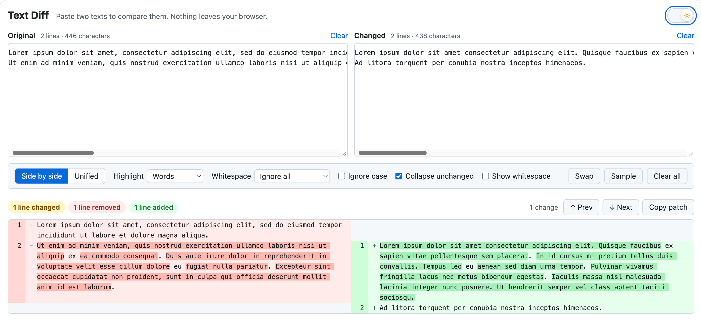

# Text Diff

A small text comparison tool. Paste two texts into the two boxes and the
differences are marked line by line, with the changed words or characters
highlighted inside each line.

The build produces **one self-contained HTML file** (`dist/index.html`) with
all JavaScript and CSS inlined. It needs no server and no network: open it
from disk, mail it, or put it on a share. The texts you paste never leave the
browser.



## Build

Requires Node.js 22.12 or newer (24 recommended).

```sh
npm install
npm run build      # type-checks, then writes dist/index.html
```

Open `dist/index.html` in a browser. That file is the whole deliverable.

Other scripts:

| Command           | What it does                                   |
| ----------------- | ---------------------------------------------- |
| `npm run dev`     | Development server with hot reload             |
| `npm test`        | Unit tests for the diff engine (Vitest)        |
| `npm run preview` | Serves the built `dist/` folder                |

## Using it

- **Side by side / Unified** switches between two columns and a single
  column with `−` / `+` lines.
- **Highlight** chooses what is marked inside a changed line: words,
  single characters, or nothing (whole lines only).
- **Whitespace** controls how spaces and tabs are compared:
  - *Compare*: whitespace counts like any other character.
  - *Ignore at line end*: trailing whitespace is ignored.
  - *Ignore amount*: any run of whitespace equals any other run, and
    trailing whitespace is ignored.
  - *Ignore all*: whitespace is ignored completely.
- **Ignore case** treats upper- and lowercase letters as equal.
- **Collapse unchanged** hides long unchanged stretches, keeping three lines
  of context around each change. Click a fold to expand it.
- **Show whitespace** draws markers for spaces (`·`), tabs (`→`) and
  non-breaking spaces (`°`) in the result.
- **Prev / Next** (or `Shift+F7` / `F7`) jump between changes.
- **Copy patch** puts a unified diff of the two texts on the clipboard.
- **Swap** exchanges the two texts. You can also drop a text file onto
  either box.

Line endings (Windows `CRLF` versus Unix `LF`) are never reported as a
difference. A difference in the final line break is mentioned in a note.

Display settings are remembered in the browser. The texts are kept only for
the current tab, so an accidental reload does not lose them.

## How the comparison works

1. Both texts are split into lines.
2. A Myers diff ([jsdiff](https://github.com/kpdecker/jsdiff)) finds the
   longest common sequence of lines, which leaves blocks of removed and added
   lines.
3. Inside each block, removed lines are paired with the added lines they
   most resemble, so an edited line appears next to its new version rather
   than next to an unrelated one.
4. Each pair is compared again, word by word or character by character, to
   mark what changed within the line.

Very large or very different texts are handled with time limits rather than
by freezing the page. When a limit is reached, every line is still shown, but
the pairing of lines or the highlighting inside lines becomes coarser, and a
note under the summary says so.

## Project layout

```
index.html              page markup
src/main.ts             UI wiring, settings, navigation, clipboard
src/diff-engine.ts      the comparison itself (no DOM access, unit-tested)
src/render.ts           turns a diff result into the table
src/style.css           styles, light and dark theme
src/sample.ts           texts for the Sample button
tests/                  Vitest unit tests
vite.config.ts          Vite + vite-plugin-singlefile configuration
```
